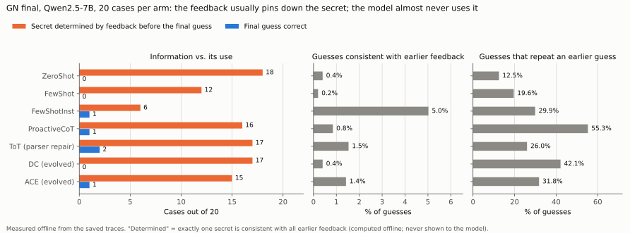
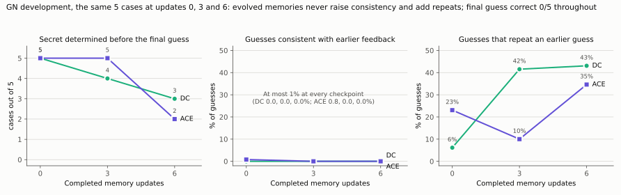

# GN: is the bottleneck acquiring information or using it?

Under the native GN protocol (25 questions, then one final guess), **information is not scarce**. Any sequence of non-repeating guesses gathers enough public feedback to pin down the secret. Uniformly random unasked guesses do this for all 5,040 secrets, but they hit the secret in only 0.48% of games. Choosing a guess that is consistent with the feedback so far on just 5% of turns raises the hit rate to 65%; at 20% it reaches 99%.

This agrees with the team's earlier GN diagnosis in [briefing.md](../../../../briefing.md): 88.9–95.7% of Qwen2.5-7B's guesses were already ruled out by its own history, and an externally computed belief state lifted the solve rate from 2% to 99%. Its consistent-guess and oracle means, 5.47 and 5.33 guesses in [experiments.md](../../../../experiments.md), match the reference below. New here are the identification result for non-repeating questions and the mixture curve.

The seven Qwen2.5-7B arms in [gn-complete](../../gn-complete/README.md) hit the secret in 0–2 of 20 cases each. Their failure therefore cannot come from the question budget being too small. It must come from asking repeated or uninformative questions, from not using the feedback they received, or both. The extraction below separates these two on the saved traces.

**Measured result ([below](#result-on-the-saved-traces-b76)):** the arms did gather the information but did not use it. The feedback had already pinned down the secret before the final guess in 101 of 140 final cases, yet only 5 final guesses were right.


## Model-free reference (exhaustive, deterministic)

Every policy plays all 5,040 four-distinct-digit secrets. It stops when the secret is hit, or after 26 guesses (25 questions plus the final guess). A policy draws a guess from the feedback-consistent secrets with probability p; otherwise it draws a uniformly random unasked guess. No policy repeats a guess.

| Policy | Consistent guesses (measured) | Identified after 25 questions | Hit within 26 guesses | Mean / max guesses to hit |
|---|---:|---:|---:|---:|
| Random unasked guess (p = 0) | 0.9% | 100% | 0.48% (24) | 15.6 / 25 |
| p = 0.05 | 6.3% | 100% | 65.2% | 14.6 / 26 |
| p = 0.1 | 11.6% | 100% | 88.5% | 13.0 / 26 |
| p = 0.2 | 22.0% | 100% | 98.8% | 10.2 / 26 |
| p = 0.3 | 32.1% | 100% | 99.96% | 8.4 / 26 |
| p = 0.5 | 52.2% | 100% | 100% | 6.9 / 19 |
| Always a random consistent guess (p = 1) | 100% | 100% | 100% | 5.46 / 8 |
| First consistent guess, lexicographic | 100% | 100% | 100% | 5.56 / 9 |
| Consistent guess with the smallest expected remaining set | 100% | 100% | 100% | 5.32 / 8 |

Full distributions are in [reference-policies.json](reference-policies.json). "Identified" means the public feedback leaves exactly one possible secret. It measures the information acquired, not anything the actor believes. The expected-remaining-set rule is the exact partition score from the [UoT diagnostic](../../uot/diagnostics/README.md), applied to consistent guesses only.

This is a mathematical reference, not a model of LLM behavior. LLM errors are not uniformly random, and the native actor is never shown the consistent set. The figure's gray band is the observed per-arm hit range; the x position of the LLM arms is unknown until their traces are measured.

## Real-data check on three UoT cases

The same per-guess metrics were run on the three complete episodes saved by the cancelled native UoT run (private evidence, bindings verified by [diagnostics v2](../../uot/diagnostics/README.md)). Of 26 logged guesses, 9 were repeats (34.6%), and 9 of 23 informed guesses were consistent with earlier feedback (39.1%). Public feedback identified the secret after turns 7, 9 and 7. In each case the harness then appended the single remaining candidate, which is the logged "success". This matches B7.4 and only illustrates the extractor; three cases support no rate estimate.

## Measuring the seven GN arms (CPU only, no model)

The private GN evidence is a `run_compare` controller directory. Run this wherever that evidence lives:

```text
python -B gn_state.py extract --controller <controller> [--controller <second segment>] --output state-tracking-gn-complete.json
```

It runs in seconds with the standard library only. For each development, final and training episode it does the following:

1. Checks the episode bytes against the run result's SHA-256 binding.
2. Checks the native target against the bound case file.
3. Recomputes every logged feedback.
4. Requires at most one complete record per evaluation slot across segments. Missing slots are counted as missing, never as failures.

The output holds only per-(phase, checkpoint, arm) aggregates:

- the consistency rate;
- the repeat, parse-failure and non-distinct-digit rates;
- bits of information acquired after 25 questions;
- how many episodes were identified, and the median turn;
- how many were hit, and how many had a correct last guess;
- how many were identified but had a wrong last guess;
- agreement with the native success flag.

A structural leak check refuses to write any string other than arm and phase names, fixed definitions and hex digests.

Interpretations fixed before the private output is seen:

- **Mostly identified, last guess wrong:** the arms gathered enough information but did not use it, which is a state-tracking or readout failure.
- **Low identification with high repeat rates:** the arms wasted questions, as UoT did. State the share explained by repeats.
- **DC and ACE metrics flat across checkpoints 0, 3 and 6:** the evolved memories did not reach the bottleneck. Changed memory text alone is not adaptation.

None of these readings is a counterfactual success estimate. A causal claim needs a new run, sketched in [the proposal bullets](../../PROPOSAL-BULLETS.md).

## Result on the saved traces (B7.6)

**Provenance.** The private outputs of the original run and of the completion run were checked against the combined audit (`PASS_COMBINED_SUFFIX_INTEGRITY`, SHA-256 `4d7f3654…`):

- the completion run's `result.json` has SHA-256 `6da5be81…`, the audit's `combined_result`;
- the original run's has `70ee180f…`, the audit's `original_result`.

Only the completion run was used. It covers all 170 evaluation slots and the 12 training episodes, with 0 missing. Every check passed, and the logged final guess agrees with the official success flag in every group, including ToT. [Anonymous aggregates](state-tracking-gn-complete.json); `python -B plot_traces.py` redraws both figures.



| Final arm (20 cases) | Determined before the final guess | Final guess correct | Consistent guesses | Repeated guesses | Median turn determined | Bits after 25 questions (of 12.3) |
|---|---:|---:|---:|---:|---:|---:|
| ZeroShot | 18 | 0 | 0.4% | 12.5% | 7 | 12.20 |
| FewShot | 12 | 0 | 0.2% | 19.6% | 14 | 11.49 |
| FewShotInst | 6 | 1 | 5.0% | 29.9% | 11 | 10.64 |
| ProactiveCoT | 16 | 1 | 0.8% | 55.3% | 15 | 12.12 |
| ToT (parser repair) | 17 | 2 | 1.5% | 26.0% | 6 | 11.93 |
| DC (evolved) | 17 | 0 | 0.4% | 42.1% | 11 | 12.15 |
| ACE (evolved) | 15 | 1 | 1.4% | 31.8% | 8 | 11.97 |

Over all 140 final cases, public feedback determined the secret before the final guess in **101**. The final guess was right in **5**. In **97**, the secret had been determined but the final guess was still wrong. The median turn is taken over the cases where the secret was determined.



On the same five development cases at updates 0 → 3 → 6, the final guess was correct 0/5 throughout:

| Learner | Determined before the final guess | Consistent guesses | Repeated guesses |
|---|---|---|---|
| DC | 5 → 4 → 3 | 0 → 0 → 0% | 6.2 → 41.5 → 43.1% |
| ACE | 5 → 5 → 2 | 0.8 → 0 → 0% | 23.1 → 10.0 → 34.6% |

Read against the interpretations fixed in advance:

- **"Mostly identified, last guess wrong" holds.** The arms gathered enough information and did not use it, which is a state-tracking or readout failure. It is the dominant pattern in every arm except FewShotInst. FewShotInst also determined fewer secrets, 6 of 20.
- **"Low identification with high repeat rates" is not the main story.** Repeats are common, 12–55% of guesses, but the remaining questions still determined the secret in most cases. FewShot and FewShotInst determined fewer, 12 and 6.
- **"DC and ACE flat across checkpoints 0, 3 and 6" holds, and is worse than flat.**
  - Consistency never rose above 1%.
  - On the same five cases, repeats rose and determination fell.
  - In the final split, DC repeats 42% of its guesses, against 13% for ZeroShot.
  - The evolved memories did not reach the bottleneck. This is descriptive: one learning trajectory, and five development cases.

**Correction of an earlier inference.** Before this run, the proposal bullets inferred that the 7B's dead guesses must also be uninformative. That inference rested on the team's earlier dead-guess rate of 88.9–95.7%, which implies 4–11% consistent guesses; at that rate the reference predicts many hits. On these traces the consistent-guess rate is lower: 0.2–1.5% in six arms, and 5.0% in FewShotInst. That is close to the chance level of random unasked guesses, 0.9%, at which the reference predicts about a 0.5% hit rate; 5/140 were observed. The questions carried enough information; the inference is withdrawn.

## Files

- `gn_state.py`: feedback (AR-Bench `compare_guess` semantics), exact state rows, the reference policies and the private extractor. Standard library only.
- `state-tracking-gn-complete.json`: the anonymous B7.6 aggregates. `plot_traces.py` redraws `gn-final-arms-state` and `gn-dev-state-curves` (SVG and PNG; the SVGs are byte-stable).
- `test_gn_state.py`: 14 tests, run with `python -I -B test_gn_state.py`. They cover:
  - feedback against the hash-pinned AR-Bench `utils_gn.py` on 20,000 pairs, including repeated-digit guesses;
  - state rows against a naive recomputation;
  - hand-made and readout-failure histories, identification by the final guess itself (not a readout failure), and malformed records;
  - reference determinism;
  - extraction from synthetic controllers: hash tampering, case mismatch, duplicate slots, list-form native targets and the leak check.
- `reference-policies.json`: produced by `python -B gn_state.py reference --output reference-policies.json` (about 20 s).
- `plot_reference.py`, `reference-policies.svg` and `reference-policies.png`: the figure (matplotlib). The SVG is byte-stable across renders.
